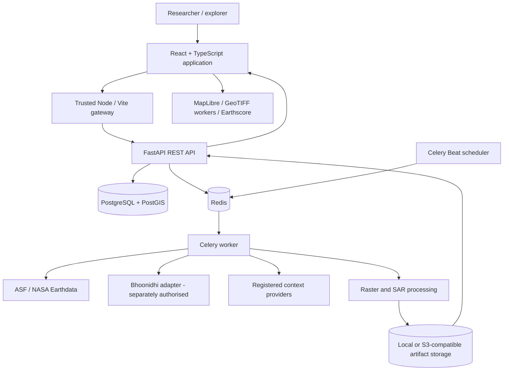

# FLAGWA — Global Surface Change Explorer

<p align="center">
  <strong>READING EARTH'S CHANGING SURFACE THROUGH RADAR</strong><br/>
  <em>From satellite signal to grounded understanding of the places we call home.</em>
</p>

<p align="center">
  <a href="https://www.spaceappschallenge.org/2026/challenges/dancing-with-the-sars/"></a>
  
  
  
  
  
  <a href="LICENSE"></a>
</p>

> **The idea:** Earth is always changing. The challenge is learning to distinguish a meaningful surface signal from noise, seasonality, geometry and incomplete evidence—and then explaining what that signal might mean for real places and people.

FLAGWA is an interactive, evidence-led exploration platform for NASA–ISRO **NISAR** synthetic aperture radar (SAR) observations. It helps users discover acquisitions, check whether observations can be compared, inspect radar products, run traceable analyses, place results in geographic context, and communicate measurements through maps, scientific summaries and data art.

It is built around a research question, not a catalogue demo:

**What changed between observations, what can radar actually tell us, what else do we need to know, and how certain can we be?**

---

## A place-led investigation: Kuttanad, Alappuzha, Kerala

<p align="center">
  <em>Kuttanad — Kerala's rice bowl, where fields, canals, backwaters and settlements form one connected landscape.</em>
</p>

For regional context, see the <a href="https://www.keralatourism.org/photo-gallery/kuttanad-rice-bowl-of-kerala-alappuzha/2738">Kerala Tourism Kuttanad gallery</a>. The gallery is linked as a reference only; its photograph is not embedded or redistributed here.

Our flagship study begins close to home: **Kuttanad in Alappuzha district, Kerala, India**. This is not simply a convenient point on a map. It is a distinctive low-lying wetland and agricultural landscape where water, paddy cultivation, canals, rivers, settlements and engineered water management are tightly connected.

Kuttanad's landscape makes radar interpretation especially interesting. Water can create strong radar contrasts, but the response is not as simple as “dark pixel = flood.” Smooth open water may return less energy toward the sensor; flooded vegetation and built structures can produce different scattering behaviour; wet soil, crop stage, wind, roughness, incidence geometry and permanent water can all affect backscatter. Paddy fields are dynamic landscapes, not static background.

This makes Kuttanad a strong place to ask a careful question: **how do radar observations of a lowland wetland-agricultural system vary between acquisition dates, and what independent evidence is needed to interpret those differences responsibly?**

The project uses an actual NISAR L-band GCOV observation pair over the Kuttanad area in its demonstrated workflow. The current result is a **radar-derived candidate requiring independent validation**. It is not a declaration of a flood event, a historical reconstruction of the 2018 Kerala floods, or a public warning. NISAR launched in 2025 and therefore did not observe the 2018 event; that event may be discussed as historical regional context only.

**Why Kuttanad matters to FLAGWA**

- **A real landscape:** the study is rooted in a specific place, not an arbitrary API response.
- **A difficult radar problem:** wetlands, flooded vegetation, paddy cycles, permanent water and human water management complicate simple classifications.
- **People and livelihoods:** agricultural land, water routes, homes and local infrastructure make contextual interpretation important.
- **A reusable method:** the same evidence chain can support future studies of forests, agriculture, glaciers, wildfire and ground deformation—once each method is independently validated.

---

## The research journey

FLAGWA turns a complex remote-sensing workflow into a sequence a researcher or curious reader can follow.

1. **Choose a place.** Begin with Kuttanad or another configured study area. Understand its geography and the question being investigated.
2. **Find the observations.** Search the available NISAR catalogue by area, date, product, frequency, maturity, orbit and acquisition metadata.
3. **Check comparability.** Confirm that the scenes, measurement layers, dates, geometry, product maturity and processing baseline support a defensible comparison.
4. **Inspect the signal.** Read product metadata and HDF5 structure. Understand which layers and polarizations are actually present.
5. **Analyse a specific question.** Run the supported workflow using explicit parameters, masks, quality controls and traceable inputs.
6. **Add context.** Relate the radar result to available land-cover, water, elevation, rainfall, population and infrastructure evidence—without inventing missing data.
7. **Interpret, validate and communicate.** Review uncertainty and provenance, compare with independent evidence, and only then make an environmental claim.

The sequence matters. A colourful map without compatible observations, physical reasoning or validation is not a scientific finding.

---

## What you can explore

| Experience | What it does | Why it matters |
|---|---|---|
| **Story** | Introduces the problem, radar evidence and FLAGWA's research approach. | Gives first-time visitors context before technical layers. |
| **Explorer** | Navigates configured locations, catalogue observations, results, map layers, comparisons, statistics, context and evidence. | Connects a geographic question to real observations and outputs. |
| **Radar Lab** | Separates qualitative radar education from inspection of real stored observations and product metadata. | Explains SAR without confusing an illustration with an actual acquisition. |
| **Groundwire** | Produces source-grounded, plain-language interpretation with dates, measured indicators and caveats. | Makes evidence easier to understand without turning hypotheses into facts. |
| **THE EARTHSCORE** | Encodes actual processed measurement samples into deterministic artwork, with linked footprints, exact values, optional user-initiated sound and attributed exports. | Offers an accessible way to communicate data while retaining scientific lineage. |
| **Scientific workbench** | Supports catalogue search, compatibility checks, authorised acquisition, processing jobs, result review and validation records. | Exposes the reproducible workflow behind the visual interface. |

Read the [User Guide](docs/USER_GUIDE.md) for user workflows and the [Frontend Reference](frontend/README.md) for implementation details.

---

## What FLAGWA currently supports

### Demonstrated research workflow

The implemented primary workflow uses compatible NISAR **L-band GCOV** observations to derive radar backscatter change and identify **potential inundation candidates** with contextual masks. The demonstrated Kuttanad processing run used an explicit AOI subset and actual acquired observation data. Its output remains pending independent validation.

The product preserves the chain between source and interpretation: scene identifiers, acquisition dates, product type, frequency, polarization/dataset selection, processing parameters, masks, result files, statistics and uncertainty notes.

### Other scientific themes

The codebase contains distinct experimental processors and typed workflows for additional themes. Their presence in code does not mean they are ready for operational environmental interpretation.

| Theme | Intended evidence | Current interpretation boundary |
|---|---|---|
| Flood / water dynamics | Comparable GCOV backscatter, water/permanent-water context and quality masks | Candidate inundation only; not confirmed flooding, flood depth or warning |
| Forest disturbance | Compatible polarimetric observations and a suitable forest mask | Experimental disturbance candidate; not confirmed deforestation |
| Agriculture | Multiple compatible dated observations and relevant crop/context information | Experimental surface-response description; not yield or a mission soil-moisture product |
| Wildfire | Radar observations, dated fire perimeter and independent optical support | Experimental fire-associated change; not burn severity or proof of cause |
| Glacier movement | GOFF offset layers, compatible units, quality information and glacier extent | Experimental radar-coordinate offset rate; not glacier retreat or ice-mass loss |
| Ground deformation | GUNW phase, coherence, frequency, reference and correction assessment | Experimental apparent relative line-of-sight displacement; not vertical subsidence or a full 3-D motion vector |

Capability status is exposed by the backend. Treat the running capability response and each result's `operational`, `result_status`, `synthetic`, `uncertainty_notes` and provenance fields as authoritative. See [Scientific Workflows](docs/ADVANCED.md).

---

## Scientific integrity is a product feature

FLAGWA exposes uncertainty instead of hiding it.

- **A job can succeed while a scientific hypothesis remains unvalidated.** Processing status and validation status are separate.
- **A change candidate is not a confirmed event.** GCOV backscatter differences can indicate a change in radar response, not uniquely explain its physical cause.
- **A measurement footprint is not an impact footprint.** Continuous measurement coverage must not be described as damaged or affected area.
- **Missing context is not zero exposure.** An unavailable population, road or settlement layer is reported as unavailable, not as no people or infrastructure.
- **A product maturity label is not independent validation.** NASA/ASF data maturity describes the satellite product; FLAGWA validation concerns the interpretation/result.
- **Illustrative radar education is not observed satellite data.** Radar Lab labels qualitative illustrations clearly.
- **No AI narrative becomes evidence.** Groundwire explanations are constrained by stored source metadata, measurements and explicit limits.

A GCOV change map does not prove flood depth. Flooded vegetation, wet paddy, soil moisture, wind, roughness, viewing geometry and processing differences can change backscatter. Responsible interpretation combines SAR with independent optical imagery, hydrological and rainfall information, water masks, terrain, local reporting and field evidence where available.

---

## Architecture at a glance



**Frontend:** React 19, TypeScript, Vite, React Router, TanStack Query, Zustand, MapLibre GL, GeoTIFF.js, proj4, Recharts, Web Audio and an Express gateway.

**Backend:** FastAPI, Pydantic, SQLAlchemy, PostgreSQL/PostGIS, Alembic, Redis, Celery, Rasterio, HDF5 inspection and local/S3-compatible artifact storage.

**Key separation:** the browser consumes public API responses. Admin, Earthdata, database and object-storage credentials stay in trusted server environments. The optional frontend artifact bridge is read-only and resolves only approved result roles.

Read [Architecture](docs/ARCHITECTURE.md), [Backend Reference](docs/BACKEND.md), [API Reference](docs/API.md), and [Configuration & Security](docs/CONFIGURATION.md).

---

## Quick start

**Requirements:** Git, Docker with Compose, Node.js 24+, npm and private environment configuration. Python 3.12 is the tested native backend runtime.

```bash
git clone https://github.com/ansonj-dev/Flagwa.git
cd Flagwa
```

Create a private root `.env` using [config/backend.env.example](config/backend.env.example). Set a local database password, matching URL-encoded database URLs and a strong `ADMIN_API_KEY`. Never commit this file or paste secrets into documentation.

```bash
docker compose up --build -d
npm --prefix frontend ci
npm --prefix frontend run dev
```

Open:

| Service | Local address |
|---|---|
| FLAGWA frontend | http://localhost:5173/ |
| FastAPI interactive docs | http://localhost:8000/docs |
| OpenAPI schema | http://localhost:8000/openapi.json |
| Backend liveness | http://localhost:8000/health/live |
| Backend readiness | http://localhost:8000/health/ready |

The migration service applies the database schema and seeds location metadata. A fresh installation does **not** include acquired NISAR scenes, processed results, contextual rasters, credentials or a populated real-data demonstration. Follow [Getting Started](docs/GETTING_STARTED.md) and [the User Guide](docs/USER_GUIDE.md) to progress from setup to an evidence-backed result.

---

## Repository map

```text
.
├── app/
│   ├── api/                 # FastAPI health and versioned REST routes
│   ├── cli/                 # Audits, acquisition, inspection, context and analysis tools
│   ├── core/                # Settings, security, errors and logging
│   ├── database/            # SQLAlchemy session and Alembic migrations
│   ├── models/              # Persistent entities and spatial records
│   ├── schemas/             # Typed API and scientific request/response contracts
│   ├── services/
│   │   ├── nisar/           # ASF, Earthdata, Bhoonidhi, compatibility and acquisition
│   │   ├── processing/      # Theme-specific raster/SAR analysis and exports
│   │   ├── context/         # Dataset registry, ingestion, masks and exposure
│   │   └── reporting/       # Scientific summary and interpretation
│   └── workers/             # Celery worker, scheduling and job heartbeat
├── config/                  # Safe env template, AOI and context/audit configuration
├── docs/                    # Product, user, science, API, deployment and development guides
├── frontend/
│   ├── server/              # Trusted Express/Vite gateway and access controls
│   ├── src/
│   │   ├── pages/           # Story, Explorer, Earthscore, Groundwire, Radar Lab, About
│   │   ├── features/        # Dedicated scientific/creative feature modules
│   │   ├── components/      # UI, maps, forms and scientific panels
│   │   ├── services/        # Typed API client and data queries
│   │   └── store/           # UI selection/view state
│   └── e2e/                 # Browser acceptance scenarios
├── scripts/                 # Original Kuttanad ASF search, download and HDF5 audit scripts
├── tests/                   # Backend unit, integration and opt-in live-provider tests
├── docker-compose.yml       # Local PostGIS, Redis, API, worker, scheduler and migration stack
└── render.yaml              # Render multi-service blueprint
```

---

## Verification and reproducibility

The repository includes frontend unit tests, browser acceptance tests, backend unit tests, integration tests guarded by environment flags and opt-in live-provider tests. Historical verification records are preserved in [Completion](docs/COMPLETION.md), [Verification](docs/VERIFICATION.md), and [Audit](docs/AUDIT.md).

Run the current commands in [Development & Testing](docs/DEVELOPMENT.md) and record the environment, test selection and result when publishing new verification evidence. Historical test counts are records of particular runs, not a guarantee about another machine or later commit.

---

## Deployment

Docker Compose is the recommended local backend environment. The repository also contains a Render blueprint for the API, Redis, worker and scheduler, plus a separately configured frontend service. Render deployment requires external PostgreSQL/PostGIS and durable shared artifact storage (or a compatible S3 service), environment secrets, HTTPS and CORS/origin configuration. A committed blueprint is not proof of a live deployment.

See [Deployment & Operations](docs/DEPLOYMENT.md) and [Configuration](docs/CONFIGURATION.md).

---

## Roadmap

The roadmap distinguishes proposed work from current capability.

- Independently validate the Kuttanad candidate with suitable optical, hydrological, rainfall, water-level, local reporting and/or field evidence.
- Replace the draft rectangular AOI with a reviewed study boundary and document its source/version.
- Improve seasonal interpretation for paddy growth, harvest cycles, wet soil, permanent water and flooded vegetation.
- Build robust, independently validated workflows for forest, agricultural, wildfire, glacier and deformation applications.
- Expand source-attributed community context coverage; keep unavailable layers explicit.
- Improve map tiling, large-raster performance, shared artifact delivery, monitoring, backup and restore.
- Add richer, reviewed L-band/S-band comparison only where genuinely comparable observations exist and access is authorised.
- Establish a formal software licence and contributor governance before broad public collaboration.

See [Roadmap & Research Agenda](docs/ROADMAP.md) for dependencies and acceptance criteria.

---

## NASA Space Apps Challenge alignment

FLAGWA responds to [Dancing with the SARs](https://www.spaceappschallenge.org/2026/challenges/dancing-with-the-sars/) by choosing a meaningful study area, working with freely available NISAR SAR observations, incorporating geographic/context datasets where available, presenting an interactive digital medium, and investigating physical explanations for observed or absent radar responses. It also describes potential future uses for repeated SAR observations in wetland and agricultural monitoring, ecosystem disturbance, cryosphere change and surface deformation.

The essential contribution is not merely calling a catalogue endpoint. It is making the reasoning chain inspectable—from acquisition and product layer through processing, context, uncertainty and interpretation.

- **Study-area choice:** Kuttanad, Alappuzha, Kerala, is the flagship case. Other configured locations are exploratory; do not assume they have compatible acquisitions.
- **NISAR data use:** product discovery, maturity/metadata inspection, compatibility checks, authorised acquisition and product-aware interpretation.
- **Supplemental context:** water, land-cover, terrain and other registered sources are shown with availability and provenance.
- **Interactive medium:** map-based Explorer, Radar Lab, Groundwire and Earthscore.
- **Physical interpretation:** hypotheses are tied to the radar observable and labelled as hypotheses until supported independently.
- **Future applications:** repeat observations may support wetland, agriculture, forest, cryosphere and solid-Earth monitoring, subject to product suitability and validation.

---

## Data, attribution and licensing

NISAR data access and product descriptions are maintained by NASA/ASF and ISRO/NRSC. Supplemental datasets retain source metadata, versions, access dates and reuse terms in the context registry where imported. A dataset's availability does not automatically grant unrestricted redistribution.

**Original FLAGWA code and project documentation authored by Anson Joseph are licensed under the [Apache License, Version 2.0](LICENSE) (SPDX: Apache-2.0).** The licence is OSI-approved and is the default licence identified in the 2026 NASA Space Apps Participant Terms when a participant does not specify another OSI-compliant licence. Third-party datasets, imagery, basemap services and software dependencies are not relicensed by this file; they retain their own terms and attribution requirements. Review [Third-party notices](docs/THIRD_PARTY_NOTICES.md), [Data Sources & Attribution](docs/DATA_SOURCES.md) and [Open-source status](docs/OPEN_SOURCE.md).

---

## Documentation map

| Need | Read |
|---|---|
| Documentation index | [docs/README.md](docs/README.md) |
| First view / product story | This README |
| Run locally and create first result | [Getting Started](docs/GETTING_STARTED.md) |
| Understand service boundaries and data flow | [Architecture](docs/ARCHITECTURE.md) |
| Use every user-facing experience | [User Guide](docs/USER_GUIDE.md) |
| Kuttanad research, evidence and validation | [Kuttanad Study](docs/KUTTANAD_STUDY.md) |
| SAR, products, methods and validation | [Scientific Workflows](docs/ADVANCED.md) |
| API operations and contracts | [API Reference](docs/API.md) |
| Server setup and operator commands | [Backend Reference](docs/BACKEND.md) |
| Secrets, providers, storage and gateway | [Configuration & Security](docs/CONFIGURATION.md) |
| Deploy and operate | [Deployment & Operations](docs/DEPLOYMENT.md) |
| Test and contribute | [Development & Testing](docs/DEVELOPMENT.md) |
| Feature internals | [Frontend Reference](frontend/README.md) |
| Research sequence and next milestones | [Roadmap](docs/ROADMAP.md) |
| Dataset provenance and citation | [Data Sources](docs/DATA_SOURCES.md) |
| Software/data licensing status | [Open-source status](docs/OPEN_SOURCE.md) |
| Common operations issues | [Troubleshooting](docs/TROUBLESHOOTING.md) |
| Historical implementation evidence | [Completion](docs/COMPLETION.md), [Verification](docs/VERIFICATION.md), [Audit](docs/AUDIT.md) |

<p align="center">
  <strong>FLAGWA</strong><br/>
  <em>Understand the signal. Respect the uncertainty. Tell the story of the place.</em>
</p>
