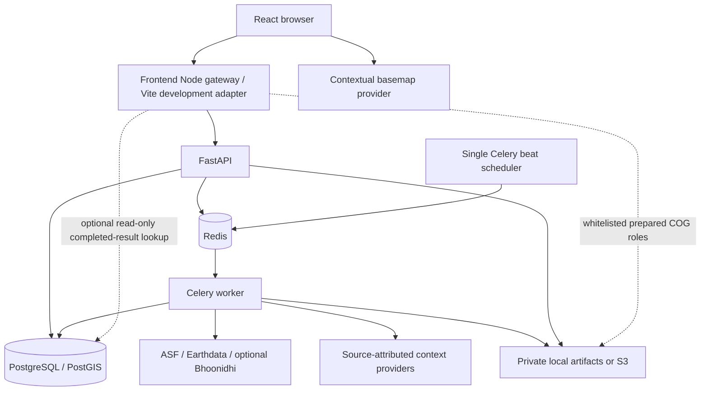

# Architecture

FLAGWA separates scientific computation, durable metadata, private artifacts and public presentation.
The backend owns measurements and validation state. The frontend reads those records and never
promotes an animation, explanatory sentence or successful software test into a scientific observation.

## System Diagram



## Responsibilities

| Component | Responsibility |
| --- | --- |
| React application | Navigation, real-record queries, linked views, accessibility and selection state |
| Frontend Node server | Static SPA/deep links, allowlisted public proxy, restricted sessions, optional artifact bridge |
| FastAPI | Typed requests, authorization, catalogue records, job submission, results/context/export contracts |
| PostgreSQL/PostGIS | Authoritative metadata, geometry, processing/review history and job state |
| Redis | Task transport, Celery results and execution coordination/leases |
| Worker | Controlled transfers, source inspection, preprocessing, science, validation and artifact publication |
| Scheduler | Periodic stale-job reconciliation; one instance |
| Artifact store | Large raw/derived/context/processed objects outside relational database blobs |

## Source Layout

```text
app/api/                  HTTP routing, envelopes, health and API v1
app/core/                 Settings, security, exceptions and logging
app/database/             SQLAlchemy sessions and Alembic migrations
app/models/               Location, scene, job, result, context and related records
app/schemas/              Pydantic catalogue/analysis/validation contracts
app/services/nisar/       Provider access, metadata, compatibility and product inspection
app/services/processing/  Raster preparation, scientific processors, COG/vector/report export
app/services/context/     Context discovery, registration and limited exposure overlays
app/services/storage/     Local and S3 abstractions
app/workers/              Celery configuration, execution and lifecycle handling
app/cli/                  Explicit operator/research utilities
frontend/src/pages/       Routed product experiences
frontend/src/services/    HTTP client and TanStack Query hooks
frontend/src/store/       View/selection state, not scientific records
frontend/src/components/  Shared UI, map, forms and evidence panels
frontend/src/features/    Earthscore, Groundwire and Radar Lab modules
frontend/server/          Trusted frontend-only gateway and static production host
```

## Scientific Data Lifecycle

1. **Discover:** query a real provider; normalize metadata without discarding original provenance.
   Catalogue availability does not establish local acquisition, geometry compatibility or validation.
2. **Select:** compare products, actual times, maturity, frequency/group, polarization, geometry and AOI.
3. **Acquire:** explicitly request full products or bounded AOI derivatives. Preserve actual identity,
   quality codes, coordinates and a checksum whose scope is accurately described.
4. **Inspect:** enumerate actual HDF5 datasets and units. Never infer an internal dataset from another scene.
5. **Prepare:** apply actual valid-data rules, preserve nodata, align scalar and categorical grids correctly,
   and snapshot study geometry/context provenance.
6. **Process:** run the selected typed workflow and record its parameters and uncertainty notes.
7. **Publish:** verify artifact integrity and job state before exposing completed result records.
8. **Review:** register independent evidence and compute appropriate metrics. Approval is separate from execution.

Source-product maturity, scene acquisition status, job completion, candidate class and independent result
validation are different states. A `VALIDATED` provider collection does not mean a flood candidate is validated.

## Jobs And Recovery

Jobs progress through supported states such as `QUEUED`, `RUNNING`, `VALIDATING` and terminal
`COMPLETED`, `FAILED`, `CANCELLED`. The database is authoritative. Heartbeats and renewable leases
prevent reconciliation from declaring a live worker stale. Cancellation is cooperative. Retry is explicit,
creates a new job with lineage, and preserves the original terminal record.

The browser polls active jobs and stops on terminal states. Readiness is not worker liveness; use Celery
inspection separately. See [operations](DEPLOYMENT.md) for reconciliation/cleanup constraints.

## Artifacts And Export

Typical outputs include a georeferenced COG, candidate/coverage GeoJSON, preview PNG, summary JSON
and processing report. Prepared before/after power and change COGs can remain private artifact roles.
Continuous-product GeoJSON is measurement coverage, not an environmental impact polygon.

Public API exports resolve actual result records rather than arbitrary client-provided filesystem paths.
Metadata sanitization excludes private artifact keys. The optional frontend bridge has a deliberately
small role allowlist and read-only completed-job lookup; it does not add backend scientific endpoints.

## Frontend Data And Rendering

- React Router lazily loads experiences. TanStack Query owns response caching, cancellation and errors.
- Zustand stores selected location, layers and view controls, not invented scientific datasets.
- MapLibre renders contextual tiles plus actual geometries and COG-derived tiles. Context optical imagery
  is labelled separately from radar evidence.
- Worker-based GeoTIFF sampling uses ranges/overviews with whole-file fallback disabled and explicit CRS
  reprojection. Categorical codes and continuous measurement scales remain distinct.
- The Radar Lab concept mode is qualitative. Observation mode uses real result, scene, preview and
  inspection APIs; catalogue polarization availability is not treated as proof of an acquired layer.
- Earthscore samples actual stored cells, keeps exact values/footprints and documents normalization.
  Map, canvas and inspector select the same sample. Sound is optional data sonification, not satellite audio.
- Groundwire builds source-grounded summaries and clearly separated hypotheses from real result metadata.

See the [Frontend Reference](../frontend/README.md) for the implementation-level mapping and adapter contracts.

## Trust Boundaries

Only the Node/API/worker environments may hold administrative, provider, database or object-storage
credentials. Public browser variables are build-time configuration, not a secret store. The Node operator
gateway exchanges a separate passphrase for a short-lived signed HttpOnly cookie and injects the backend
admin key only into allowlisted server-to-server operations. Read-only bridge database/storage rights
should be narrower than backend processing rights.

Software fixtures are explicitly marked synthetic and must not become public scientific evidence or
pass independent validation gates. No external generative AI or music service is required by Earthscore.